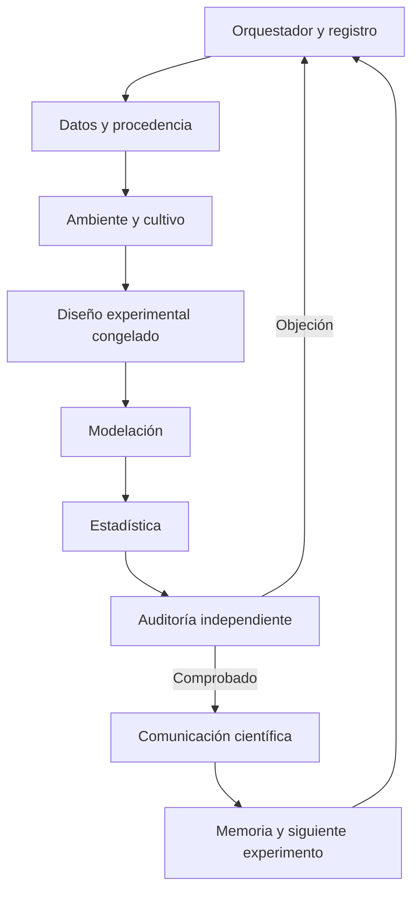
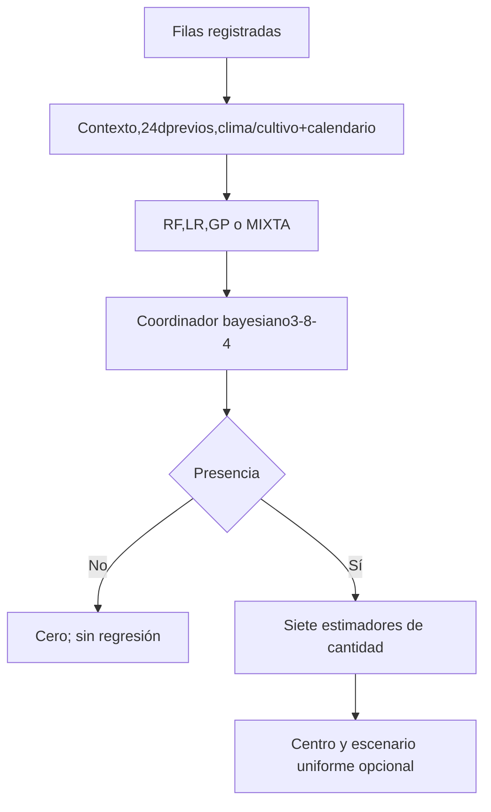

# Arquitectura de agentes y modelos

Los agentes son componentes de software deterministas con entradas, funciones, verificaciones y devoluciones. No son LLM ni especialistas humanos. La orquestación no requiere credenciales de IA.

`agentes.py` implementa responsabilidades y verificaciones. `registro.py` guarda mensajes con UUID, emisor, receptor, acción, evidencia, estado, respuesta y fecha, en JSONL y SQLite. `orquestador.py` ejecuta tareas, registra interrupciones y retoma modelos ya completos; cambios de fuentes o configuración requieren otro experimento. `verificacion.py` reproduce elecciones y predicciones desde los artefactos.

Por cada arquitectura se comparan variables completas yACP95% de las continuas. Mes/día categóricos, senos/cosenos del calendario e indicadores no entran aACP ni expansiones polinomiales. Los polinomios2/3de continuas son completos, con interacciones; se regularizan porRidge. La inversa de log1p comparaexpm1consmearing de calibración.

Contexto conserva los modelos/OOF anteriores, pues sus entradas no cambian. Se reentrenan72ajustes base de antecedentes/individuo(2representaciones×3familias×2vistas×6ajustes), más8coordinadores bayesianos. Cantidad:14ajustes finales, con calibración interna previa.

La memoria registra conclusiones comprobadas y pendientes; no autoentrena ni promueve modelos con la prueba. Intervención científica: confirmar unidad y ceros, fechas, costosFP/FN y validez de una nueva cohorte.
