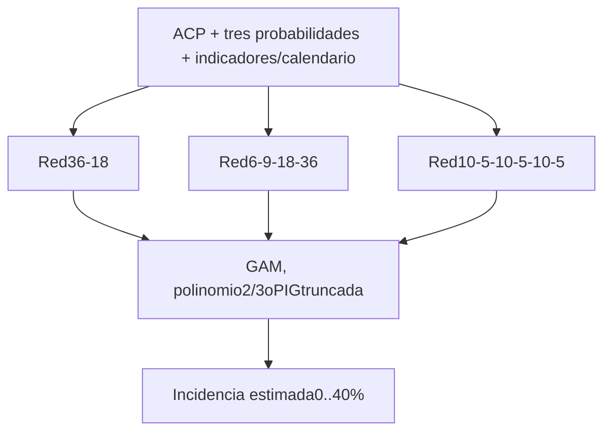

# ACP, probabilidades y tres redes

Confirmaciones:respuesta=porcentaje de incidencia; rango solicitado0..40puntosporcentuales; mezclaPoisson–inversa gaussiana como opción; máximo100negativos en entrenamiento de cantidad. La base observada tiene enteros0..36. No se convierten a conteos de hojas ni se inventa denominador.

Redes acotadas por40*sigmoid,80epochs,Adam,semillas42/43/44. Cadafold ajusta imputación,escala,ACP yredes sólo con su entrenamiento. Los fusores aprenden con las tres salidasOOF en5folds porcoordenada; luego redesfinales usan11,900positivos+100ceros. Los100ceros se eligen reproduciblemente, estratificados pormunicipio; sus identidades sólo se conservan en privado.

GAM:logit(E[y]/40)=beta0+s1(red1)+s2(red2)+s3(red3), con splines cúbicos univariados y pérdida fraccional penalizada. Polinomios:mismo enlace y términos completos de grado2/3sobre las tres salidas. PIG:mezclaPoisson–IGnormalizada al soporte0..40; predice su media. Hipótesis para porcentajes discretos, no número de hojas. Porcentajes no enteros rechazanPIGsinredondear; GAM ypolinomios admiten decimales.

ClasificaciónLR/ACPprevia congelada. Puerta negativa devuelve0sin ejecutar redes/fusores de cantidad. Enprueba conservaTN8580,FP1825,FN70,TP6877. No se presenta como un nuevo detector de presencia.

La comparación anterior corregida usa polinomios2/3completos de[PC,p]; armónica múltiple con senos/cosenos anuales y productosPC/p×armónicos; regresor genéticoMSE con árbol3niveles y escalaafín train. Entradas auxiliares comunes y control sinprobabilidades. Probabilidades de train sonOOF de3clasificadores base; validación/prueba usan modelos de train. No entra la probabilidad delBNNporque faltaOOFanidado de ese nivel.

La prueba histórica se ha reutilizado. HayOOFenambas capas, pero no validación anidada completa de todos los módulos históricos. Se necesita otra temporada yparcelas. Reducir ceros cambia prevalencia de entrenamiento; no se reducen envalidación/prueba. No afirmar mejora sólo por añadir redes.

Resultados públicos:reports/avanzado. Modelos,prediccionesporfila ymuestreo:runs/acp_probabilidadesyruns/tres_redes_100_negativos, excluidos deGit. entrenar-avanzadoorquesta,reanuda yregistra evidencia;verificar-avanzadoreproduce salidas.
