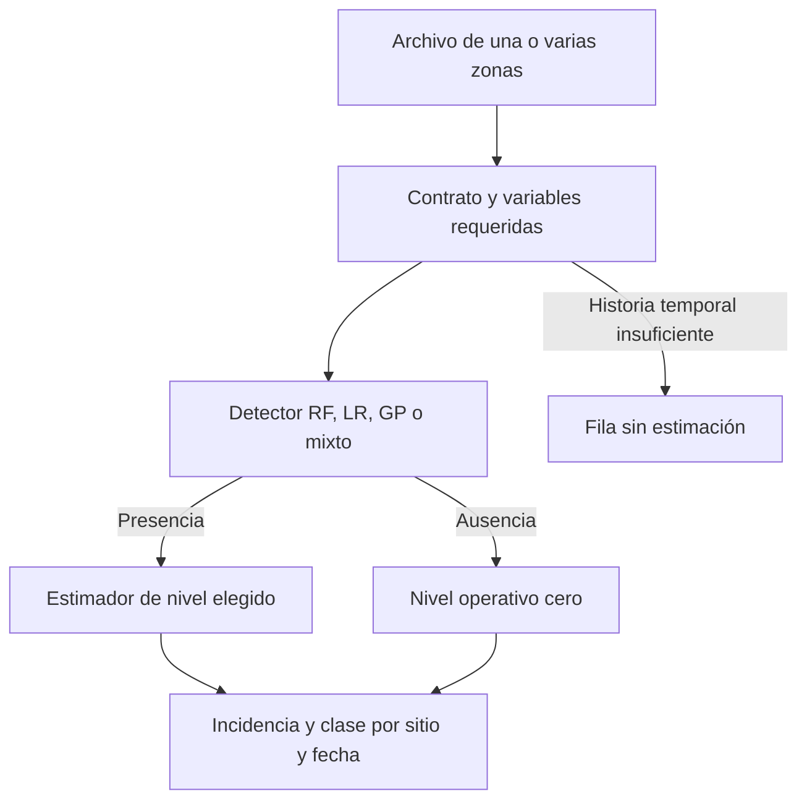

# Bases nuevas: presencia y nivel de roya

La sección **Proyecto y municipios** de `streamlit run app.py` admite registros ajenos al
catálogo histórico. Permite entrenar versiones y aplicar una combinación a una
o varias zonas. Los proyectos se separan por propietario y nombre bajo `ROYA_WORKSPACE_DIR`
(o `runs/proyectos/` en local); no se publican en GitHub. Consulte la
[guía municipal](ESTUDIOS_MUNICIPALES.md) para conservación, respaldo y ámbitos.
No se sobreescribe un estudio existente.

## Dos tareas distintas

**Entrenar con una base etiquetada.** Cargar XLSX o CSV con la incidencia
observada, incluidos los ceros reales. Asignar variables a las tres fuentes,
declarar cuáles son categóricas y elegir diagnóstico o antecedentes temporales.
El sistema entrena las cuatro alternativas y los diez estimadores de nivel,
evalúa sus combinaciones y guarda modelos, contrato, protocolo y resultados.
Una base nueva no se une automáticamente al histórico: si se desea entrenar
con ambas, se debe cargar una base consolidada sin duplicados.

**Estimar presencia y nivel.** Seleccionar una versión ya entrenada, un detector
y un estimador de nivel. Cargar los sitios y fechas a consultar. La incidencia
de esos registros puede faltar o estar vacía: nunca se utiliza para calcular
sus resultados. Se puede procesar una zona o varias en el mismo archivo.



## Columnas y fuentes

Se reconoce el formato original y se normalizan los acentos de nombres conocidos.
La identidad predeterminada es `Municipio`, `Parcela`, `Coordenada_X`,
`Coordenada_Y`. Si existen plantas distintas en el mismo sitio y fecha, añadir
`Planta` a la identidad con la casilla correspondiente. Los identificadores no
entran al aprendizaje; las coordenadas pueden asignarse a la vista topográfica.

El tiempo se proporciona como `Fecha_muestreo_exacta`, o `Mes_registrado` con
año y mes ISO y `Quincena` 1/2. En el segundo caso se aproximan las fechas a los
días 1/16; no se afirma conocer el día exacto. Mes y día se incorporan como ciclos
de seno y coseno. Un número de mes aislado no identifica un período.

| Fuente | Variables posibles |
|---|---|
| Topografía y urbanismo | Coordenadas, altitud, pendiente, orientación, distancias a agua/caminos/zonas urbanas, comunidades calculadas sin información futura |
| Excel | Temperatura promedio, punto de rocío, temperatura, humedad específica, humedad relativa, precipitación, fenología y variedades |
| Simulación | Temperatura y humedad simuladas, estadísticas previas y ventanas de condiciones favorables ya calculadas |

Cada variable pertenece a una sola fuente. Las etapas `Brotacion`, `Floracion`,
`Amarre`, `Lechoso`, `Consistente`, `Maduro` son indicadores 0/1 independientes;
varias pueden coexistir. Orientación N/S/E/O es categórica. La incidencia actual
y `fila_excel` nunca son predictores. Tipos, columnas, normalizadores y ACP
quedan dentro de la versión.

Una tabla complementaria opcional permite añadir variables estáticas por sitio
o variables dinámicas por sitio y fecha. Exige una correspondencia única y no
admite sitios sin correspondencia, columnas repetidas ni incidencia observada.
No descarga ni inventa cartografía o clima. Para nuevas zonas se necesita obtener
esas covariables con el mismo procedimiento, proyección y unidades de entrenamiento.

## Cuando falta una variable: preguntar, simular o asumir cero

El panel identifica las columnas y celdas faltantes y ofrece, para cada variable:

1. **Aportar un valor.** Solicita un valor al usuario. El valor común se aplica
   sólo a celdas vacías; para valores distintos por sitio se completa el archivo
   o se adjunta una tabla complementaria.
2. **Usar simulación disponible.** Se selecciona explícitamente la columna
   simulada que sustituye a la faltante. La versión conserva las variables
   simuladas proporcionadas en su base, sin etiquetas de roya; también se puede
   adjuntar otra tabla. Se exige correspondencia exacta de sitio y fecha. No se
   recicla el año, no se inventa humedad faltante y no se aproxima otro sitio.
3. **Asumir cero.** Opción autorizada expresamente por el usuario. El cero se
   introduce en las unidades originales y después se aplican los normalizadores
   guardados. No equivale a un valor observado ni necesariamente a ausencia de
   una condición ambiental.

La incidencia desconocida para entrenar, los identificadores y las fechas no se
completan con estas reglas. La salida incluye `variables_cero`,
`variables_simulacion`, `variables_usuario` y un aviso de sustituciones en el
historial. En entrenamiento el protocolo conserva reglas y recuentos. Un cero
asumido en una variable denominada simulada no se guarda como simulación auténtica
para futuras sustituciones. Si no existe simulación para una fecha, el usuario
debe aportar valores o elegir cero; no se cambia silenciosamente de estrategia.

Asumir cero puede situar una entrada fuera del dominio de entrenamiento, por
ejemplo temperatura cero frente a muestras de 15–28 °C. El programa lo señala;
esa posibilidad técnica no demuestra que la predicción conserve su calidad.

Las tres fuentes son necesarias para estas arquitecturas. Si el Excel original
no contiene simulación o topografía, no basta con renombrar sus columnas: deben
incorporarse las variables complementarias o autorizar y documentar sustituciones.
Entrenar toda una fuente con ceros asumidos no aporta información de esa fuente.
La selección manual debe conservar
la definición científica de las variables y el origen causal de las comunidades.

## Detectores y estimadores combinables

| Detector | Composición |
|---|---|
| RF | Un Random Forest por fuente |
| LR | Una regresión logística por fuente |
| GP | Un modelo de programación genética de hasta tres niveles por fuente |
| MIXTA | La mejor fuente de cada familia según Brier OOF de entrenamiento |

Cada alternativa fusiona tres probabilidades mediante Bayes inverso aproximado
con contexto de mes. Su umbral se elige por tasas ponderadas de falsos positivos y negativos en
validación. Una reserva cronológica final de OOF de entrenamiento permite
calibración logística si contiene ambas clases y al menos ocho filas, y el bloque
anterior contiene ambas clases. En caso contrario se conserva la probabilidad
aproximada y se registra el motivo. Se informa Brier antes/después en validación
y prueba; ajustar calibración no garantiza mejorarla. No se supone independencia
científica de expertos correlacionados.

Los diez estimadores de nivel son lineal múltiple, lineal de `log(1+y)`, polinomios
de grados 2/3, armónica, armónica polinómica de grado 2, red 20–30–30–40 y redes
bayesianas de 3/4/5 capas de 13 neuronas. Las armónicas añaden dos órdenes de
Fourier de mes y día. La polinómica armónica incorpora sus interacciones.
Se regularizan las regresiones con Ridge. La representación ACP conserva hasta
diez componentes; la opción completa exige controlar la expansión polinómica.

La cantidad aprende únicamente con positivos reales del bloque de entrenamiento
que tienen probabilidades OOF causales. Usa covariables y las nueve probabilidades
expertas, de forma independiente del detector seleccionado. No se excluyen los
positivos que el detector se equivocaría al clasificar. Una elección de presencia
no cambia el modelo de cantidad; sólo determina qué filas lo ejecutan.

No se añade ruido a la respuesta, no se aumentan datos automáticamente y no se
interpreta una incidencia porcentual como número de hojas. Las redes bayesianas
usan cuasipérdida de Poisson para una media positiva. El máximo de incidencia
declarado se aplica al resultado; por defecto es 40 puntos porcentuales.

## Diagnóstico y antecedentes temporales

- **Diagnóstico en fecha:** utiliza clima y fenología de la fila consultada. Puede
  procesar fechas nuevas con las covariables requeridas. No es un pronóstico antes
  de observar esas covariables.
- **Un paso adelante:** la topografía es del sitio; clima y fenología se toman de
  la observación real inmediatamente anterior del mismo sitio. Incorpora roya
  medida en t−1 y t−2, días transcurridos entre observaciones y calendario de la fecha objetivo. La solicitud requiere una
  tabla de historial medido con las mismas variables. Sólo se consultan filas con
  fecha estrictamente menor a la objetivo. No se usan predicciones de otras filas
  como antecedentes ni mediciones de otros sitios. Una secuencia de solicitudes
  futuras sin nuevas observaciones no acredita pronóstico recursivo.

Los rezagos son observaciones anteriores, no días fijos. Un cero histórico es una
ausencia real válida. Dos antecedentes inexistentes no se rellenan con ceros: la
fila conserva su identidad, pero la probabilidad y el nivel quedan vacíos.

## Protocolo y límites de la evidencia

Se requieren al menos diez fechas elegibles y ambas clases en entrenamiento.
Las fechas completas se ordenan y separan aproximadamente 60/20/20, sin mezclar
la misma fecha entre bloques. Dentro de entrenamiento se generan probabilidades
OOF con ventanas expansivas; cada fecha se predice con fechas anteriores. Cada
ventana vuelve a ajustar su preprocesado. Se necesitan al menos diez positivos
OOF para entrenar cantidad. La validación elige umbrales y la pareja detector/estimador entre las cuarenta
combinaciones mediante `peso_FN*FNR + peso_FP*FPR + MAE_cascada/maximo`.
Los pesos son explícitos y positivos (por defecto uno). Se conservan métricas
condicionales, pero la selección considera también los errores de la cascada.
Sin soporte de ambas clases y positivos en validación no hay pareja automática.
La prueba no participa en selección ni ajuste.

Se guardan ocho matrices de presencia (cuatro alternativas × dos bloques), veinte
evaluaciones del nivel entre positivos y ochenta evaluaciones de cascadas completas
(cuarenta combinaciones × validación/prueba). Todas las combinaciones comparten
partición y población de evaluación. Estas tablas separan error condicional y
error total. Si un bloque contiene una sola clase o incidencia constante, ciertas
métricas no están definidas y permanecen vacías. Sin ambas clases en validación no
se selecciona automáticamente detector; sin positivos no se selecciona cantidad.

Aplicar datos de otra zona es técnicamente posible, pero su calidad necesita una
evaluación externa por zona y temporada, con calibración de probabilidades y
comparación contra persistencia/cero. El corte temporal no reserva zonas nuevas.
El programa señala sitios/categorías inéditos, imputaciones y valores fuera del
rango observado. No promueve automáticamente el modelo para uso operativo.

Las pruebas del software usan datos sintéticos identificados como tales. No
constituyen una nueva medición de calidad científica en los datos del café.
Los modelos históricos y sus métricas se conservan en su área anterior. Sus
pesos dependientes del catálogo no se convierten automáticamente: para utilizar
el nuevo flujo hace falta entrenar una versión portátil con sus variables.

## Resultados y guardado

El CSV de salida conserva fila, sitio y fecha e incluye probabilidad de roya,
presencia, nivel, clase `ceil(nivel/3)` y avisos. Clase 0 corresponde a ausencia;
para decimales: clase 1 es `(0,3]`, clase 2 `(3,6]`, etc. Si un detector positivo
se combina con un regresor que devuelve cero, se señala esa inconsistencia y no
se le asigna clase 0. No equivale a una ausencia confirmada.

## Informes, figuras y evidencia por versión

La sección global **Informes y gráficas** permite revisar los seis PDF y los
archivos de figuras históricos del repositorio sin necesitar los pesos privados.
Incluye las comparaciones previas de cuatro arquitecturas, regresiones con
variables completas/ACP, correlaciones, matrices, calendarios y protocolos.
La descarga completa conserva estos experimentos separados por carpeta.

Cada entrenamiento nuevo guarda además `evaluacion_real_predicha.csv`, con la
respuesta observada, las probabilidades de los cuatro detectores y los diez
niveles estimados en validación y prueba. A partir de esa evidencia genera
automáticamente `informe/INFORME.pdf` y figuras exportables. El informe incluye:

- Arquitectura, población y protocolo de la versión, reglas de sustitución y
  límites de la evaluación.
- Ocho matrices de confusión: cuatro detectores en validación y prueba.
- Ochenta paneles de real frente a predicho de cascadas completas: cuatro
  detectores por diez estimadores por dos bloques. Incluyen las filas negativas
  y los errores del detector.
- Veinte paneles del nivel entre positivos reales: diez estimadores por dos
  bloques. Aíslan la cantidad y no equivalen a la cascada completa.
- Distribución del error y medias observadas/estimadas por fecha para la
  combinación seleccionada, o una referencia identificada si no hubo selección.

Los archivos de figuras son mosaicos con varios paneles. Los conteos de paneles
no son conteos de archivos independientes. El PDF y las figuras pueden
descargarse desde el panel de la versión. No se genera una nube artificial de
puntos a partir de métricas agregadas. Una versión antigua sin pares guardados
conserva sus métricas, pero necesita reevaluación o reentrenamiento con su base
para producir esta visualización nueva.

Los modelos se guardan localmente con datos de trazabilidad en un paquete
`modelo.joblib`, `protocolo.json`, `matrices.csv`, `cantidad.csv`, `cascadas.csv`.
Sólo deben cargarse paquetes de confianza: un archivo joblib puede ejecutar código.
El panel permite escoger versiones locales y no admite subir pesos arbitrarios.

La nueva función trabaja sin `ROYA_DATA_DIR` ni el paquete histórico: necesita la
base propia y sus covariables. El despliegue de un servicio compartido requiere
proteger los archivos privados; esta actualización no publica un servidor.

## Uso desde Python y línea de comandos

```python
from roya.entrada_excel import read_input
from roya.bases_nuevas import Contract, train, save, predict, load_model

contract = Contract(
    views={
        'topografia': ['Coordenada_X', 'Coordenada_Y', 'Altitud', 'Orientacion'],
        'excel': ['Temperatura', 'Humedad_relativa', 'Floracion'],
        'simulacion': ['temperatura_simulada', 'humedad_simulada'],
    },
    numeric=['Coordenada_X', 'Coordenada_Y', 'Altitud', 'Temperatura',
             'Humedad_relativa', 'Floracion', 'temperatura_simulada', 'humedad_simulada'],
    categorical=['Orientacion'], temporal=False,
)
bundle = train(read_input('base_etiquetada.xlsx'), contract)
save(bundle, 'runs/bases_nuevas/version_001')
result = predict(bundle, read_input('zonas_nuevas.xlsx'),
                 detector='GP', regressor='log1p_lineal')
result.to_csv('roya_por_sitio.csv', index=False)
```

El contrato también puede almacenarse como JSON con los mismos campos:

```bash
roya entrenar-base base_etiquetada.xlsx contrato.json runs/bases_nuevas/version_001
roya predecir-base zonas_nuevas.xlsx runs/bases_nuevas/version_001 salida.csv --detector GP --nivel log1p_lineal
```

Para una versión temporal, añadir `--historial historial_medido.xlsx` a la
predicción. La tabla debe incluir las covariables y la incidencia observada.

Para autorizar sustituciones desde CLI, añadir `--reglas reglas.json` y, si se
necesita una fuente adicional, `--simulacion simulacion.xlsx`. Las reglas son
por predictor; por ejemplo:

```json
{
  "Humedad_relativa": {"mode": "simulation", "source": "Humedad_relativa_simulada"},
  "Precipitacion": {"mode": "zero"},
  "Temperatura": {"mode": "value", "value": 21.5}
}
```

Estas reglas sólo se ejecutan donde falta el valor. El historial puede tener
sus propias reglas con `--reglas-historial reglas_historial.json`.
